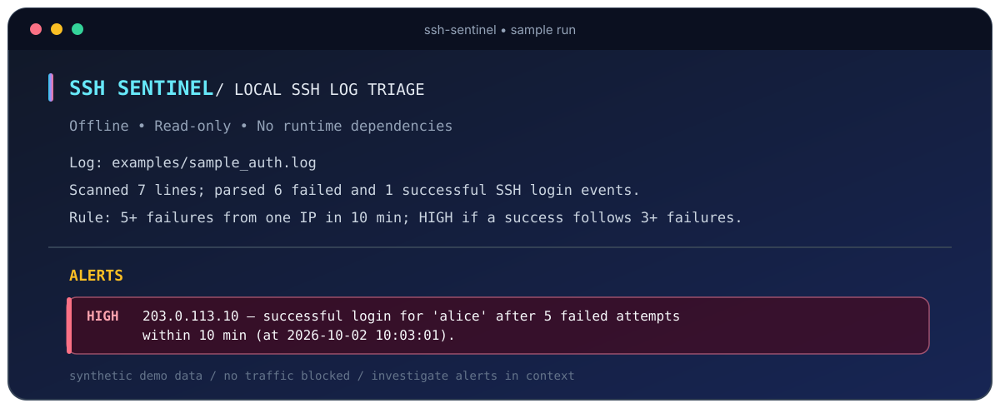
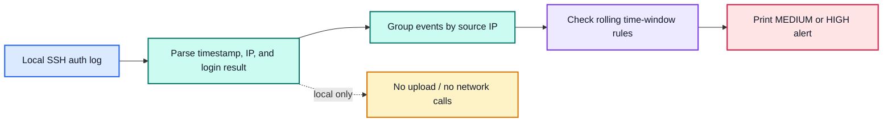

<p align="center">
  
</p>

<p align="center">
  <a href="https://www.python.org/"></a>
  
  <a href="LICENSE"></a>
  
</p>

<p align="center"><strong>Small, understandable SSH brute-force detection from a local log file.</strong><br>
No cloud account. No telemetry. No automatic blocking.</p>

---

## What it does

**SSH Sentinel** is a lightweight Python command-line tool for spotting a couple of useful SSH authentication patterns in Linux/OpenSSH logs:

- **MEDIUM:** the same IP has at least **5 failed SSH logins in 10 minutes**.
- **HIGH:** a successful SSH login follows at least **3 failures from that IP in 10 minutes**.

Thresholds and the time window are configurable. The tool reads the file you give it, prints a concise alert summary, and leaves the original log untouched.

## Preview

The sample log is synthetic and uses documentation-only IP addresses. Run it yourself with `ssh-sentinel examples/sample_auth.log`.

<p align="center">
  
</p>

```text
SSH SENTINEL  /  LOCAL SSH LOG TRIAGE
Offline  •  Read-only  •  No runtime dependencies
Log: examples/sample_auth.log
Scanned 7 lines; parsed 6 failed and 1 successful SSH login events.
Rule: 5+ failures from one IP in 10 min; HIGH if a success follows 3+ failures.

Alerts:
- HIGH   203.0.113.10 — successful SSH login for 'alice' after 5 failed attempts
  within 10 min (at 2026-10-02 10:03:01).
```

## How it helps

- **Spot a basic brute-force pattern:** groups failed SSH attempts by source IP and time window.
- **Prioritize review:** a successful login after repeated failures is highlighted as high severity.
- **Keep analysis local:** log contents are not uploaded or sent to a service.
- **Stay easy to inspect:** the rules are deliberately small and configurable—useful for learning, triage, or a starter defensive project.

> An alert is a lead to investigate, not proof of compromise. A legitimate user, an automated job, or a security test can also produce repeated failures.

## How it works



## Installation

### Requirements

- Python **3.10 or newer**
- Linux, macOS, or Windows can run the tool. The detector is aimed at **Linux/OpenSSH-style log files**.
- No third-party runtime packages are required.

### 1. Get the repository

After you publish this repository to your GitHub account, replace `<YOUR-USERNAME>` below with your GitHub username:

```bash
git clone https://github.com/Murli-B/ssh-sentinel.git
cd ssh-sentinel
```

Or download the repository ZIP from GitHub and open a terminal in the extracted `ssh-sentinel` folder.

### 2. Create and activate a virtual environment

**Linux / macOS:**

```bash
python3 -m venv .venv
source .venv/bin/activate
```

**Windows PowerShell:**

```powershell
py -m venv .venv
.\.venv\Scripts\Activate.ps1
```

### 3. Install the command

```bash
python -m pip install -e .
```

The editable install creates the `ssh-sentinel` command. It uses Python's standard library at runtime.

## Usage

### Run the included demo

```bash
ssh-sentinel examples/sample_auth.log
```

### Inspect an authorized Linux SSH log

Common locations include:

```bash
ssh-sentinel /var/log/auth.log   # Debian / Ubuntu
ssh-sentinel /var/log/secure     # Some RHEL-family systems
```

You need permission to read the chosen file. If your system logs to the journal instead, export an authorized copy first; for example, the service name may be `ssh` or `sshd`:

```bash
sudo journalctl -u ssh --since "24 hours ago" --no-pager > ssh.log
ssh-sentinel ssh.log
```

Use the appropriate service name for your system. Keep exported logs private: they may contain usernames, IP addresses, and timestamps.

### Adjust the detection rule

```bash
ssh-sentinel /path/to/auth.log --threshold 8 --success-after 4 --window-minutes 15
```

| Option | Default | Meaning |
|---|---:|---|
| `--threshold` | `5` | Failed attempts from one IP that trigger a MEDIUM alert |
| `--success-after` | `3` | Failures before a later successful login is HIGH severity |
| `--window-minutes` | `10` | Rolling time window for both rules |
| `--year` | Current year | Year to use for classic syslog timestamps that omit the year |
| `--version` | — | Print the installed version |

See all flags with `ssh-sentinel --help`.

## Run tests

From the repository root:

```bash
python -m unittest discover -s tests -v
```

A GitHub Actions workflow runs the tests on Python 3.10–3.13 for pushes and pull requests.

## Detection scope and limitations

- Detects explicit OpenSSH `sshd` **failed password/public-key/keyboard-interactive** events and corresponding `Accepted` events.
- Accepts classic Linux syslog timestamps and ISO timestamps. Classic syslog omits the year; the tool assumes the current year unless `--year` is supplied.
- Analyzes a **saved file once**. It is not a live monitor, SIEM, endpoint protection product, vulnerability scanner, or general-purpose malware detector.
- It does not block IPs, change firewall rules, or contact a network service.
- Log formats differ. If events are not recognized, check the log format and the detector's parsing rules before relying on its results.
- Review alerts in context; this simple heuristic can create false positives and can miss threats.

Use it only with systems and logs you own or are authorized to review. See [SECURITY.md](SECURITY.md) for safe handling guidance.

## Contributing

Issues and improvements are welcome. Please use synthetic or fully redacted logs in examples and tests. See [CONTRIBUTING.md](CONTRIBUTING.md).

## License

MIT — see [LICENSE](LICENSE).
